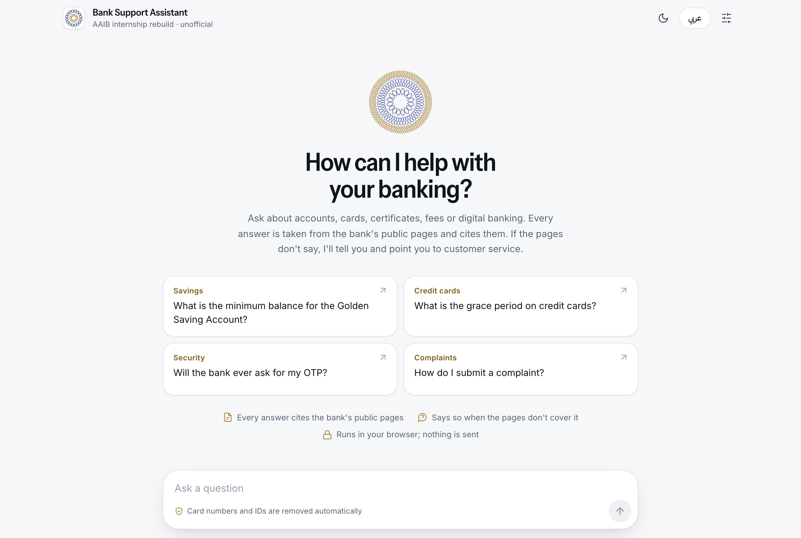
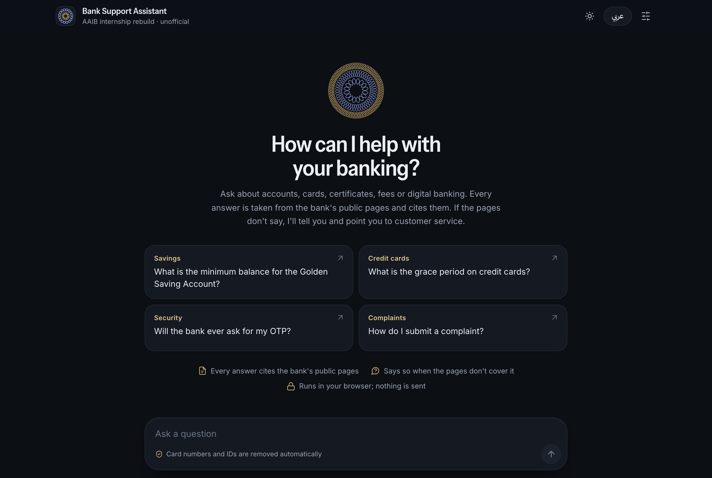
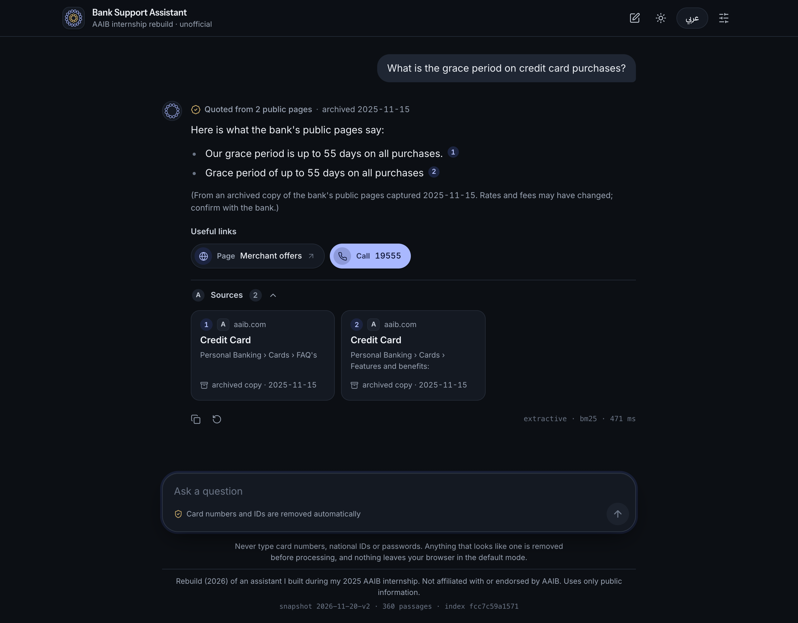
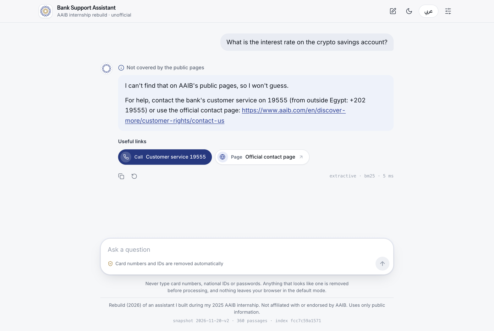
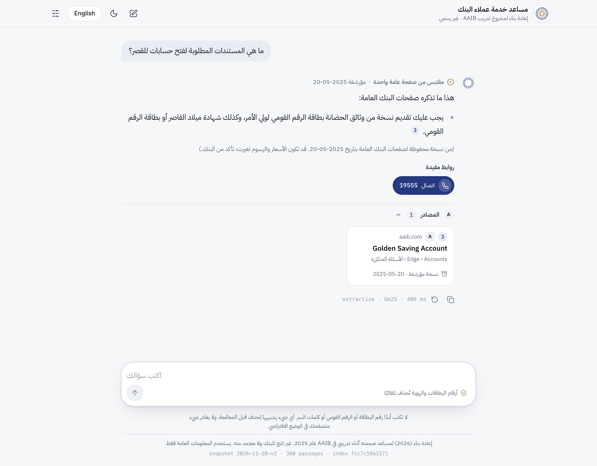
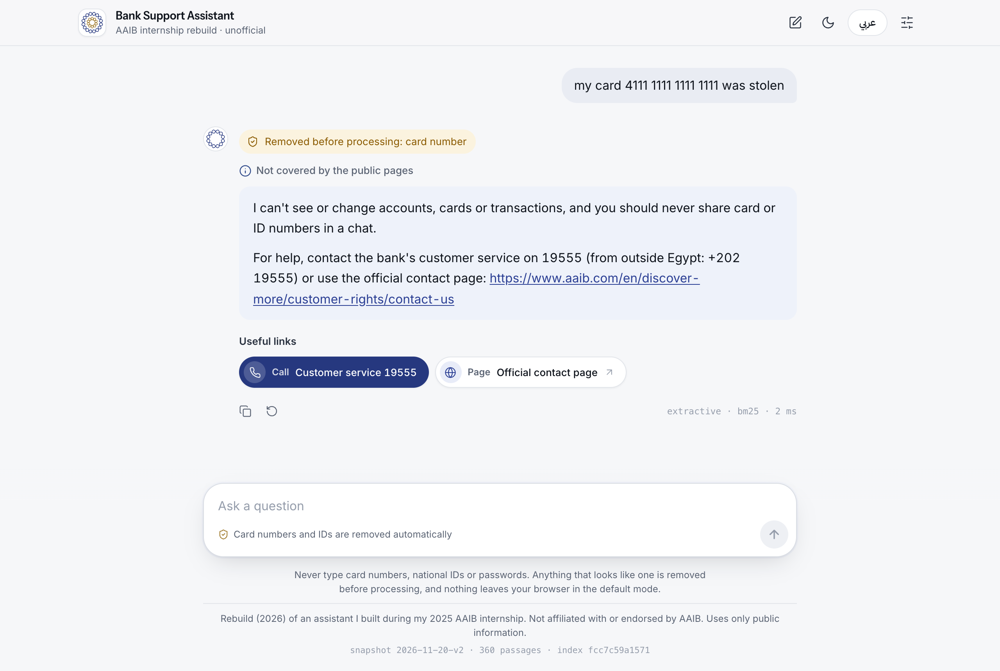
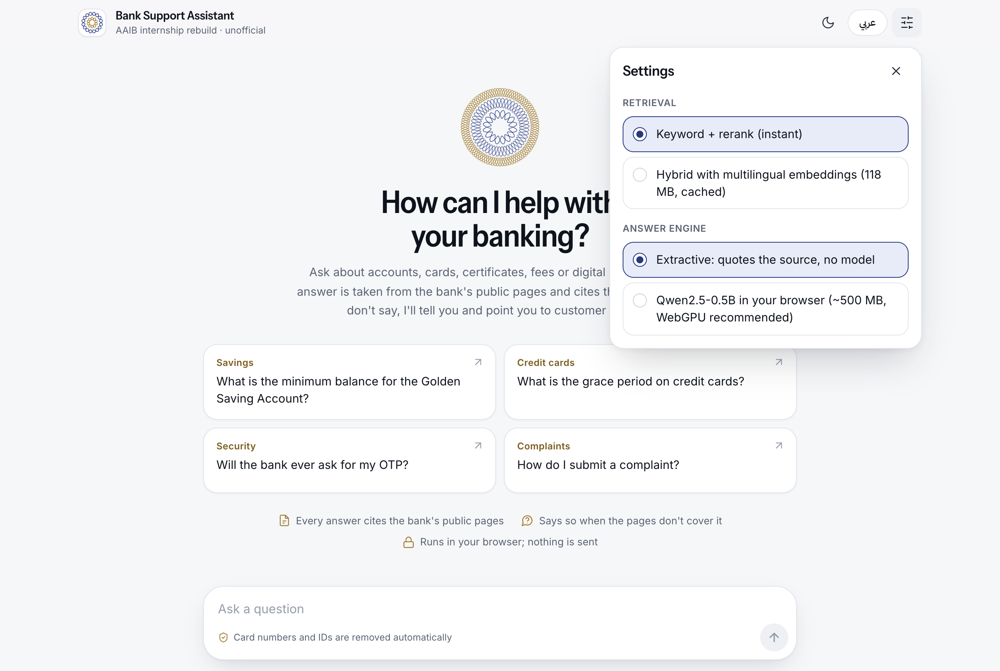
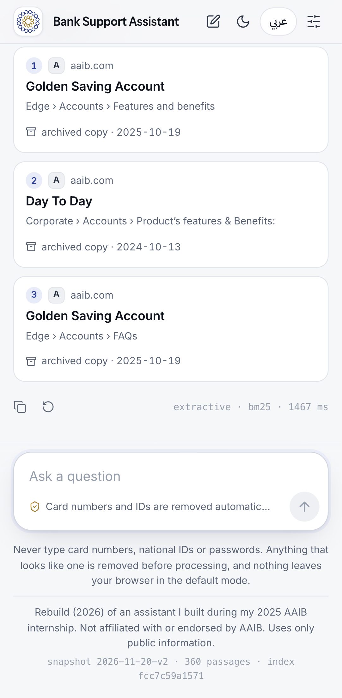
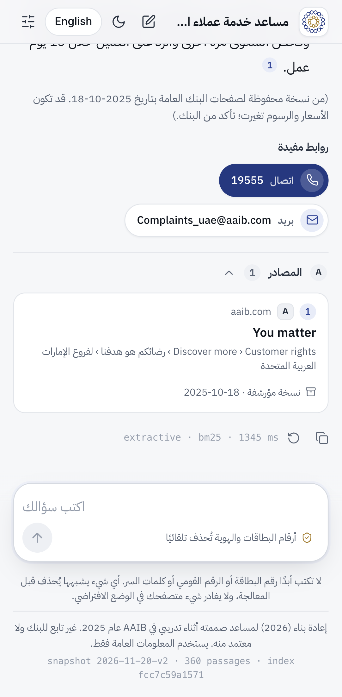
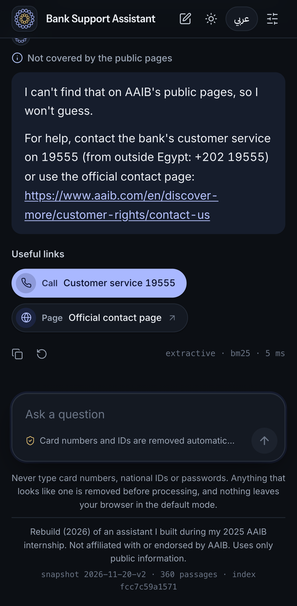

# Bank Support Assistant (AAIB internship rebuild)

> **Rebuild (2026) of an assistant I built during my 2025 AAIB internship. Not affiliated with or endorsed by AAIB. Uses only public information.**

From July to September 2025 I was a Software Engineering intern at the Digital Factory of Arab African International Bank (AAIB) in Cairo. There I built an end-to-end banking support assistant: an HTML/CSS/TypeScript frontend, knowledge scraped from the bank's public website, retrieval over that knowledge and local inference with Ollama. I documented its data flow for the bank's internal review, and the dev team adopted it. That code stayed with the bank. This repository is a rebuild from scratch, done in 2026 with more engineering discipline: a versioned and auditable knowledge snapshot, hybrid retrieval, guardrails that are tested, and an evaluation harness with measured numbers.

The default demo costs nothing to run. It is a static site with no server, no API keys and no paid model. Answers are extractive, which means they quote the source. An LLM is optional and runs inside the visitor's browser. Ollama is kept as a local dev provider, like in the original.


More in [Screenshots](#screenshots).

## What it does

- Answers questions about public retail, SME and corporate products, FAQs, complaints and security guidance, in **English and Arabic** (Arabic shown right to left).
- **Every answer cites its sources.** Each claim carries a citation marker, and each source chip links to the public page plus the exact archived capture it came from.
- **Useful links under every answer.** Ingestion extracts the links inside each page section (tariff PDFs, product pages, app-store links, the hotline, the bank's e-mail addresses). Under the sources, the answer shows up to 5 of them, taken from the chunks it cites. A refusal shows the hotline and the official contact page instead.
- **Never invents rates or fees.** Every number in an answer must appear in a cited source chunk. In extractive mode this holds by construction. In LLM mode a verifier removes any sentence with an unsourced number; if nothing verifiable is left, it falls back to the quoted text.
- **Refuses when the pages do not cover the question**, with the reply "I can't find that on AAIB's public pages", plus a handoff to the real support channel (hotline 19555 and the official contact page).
- **Guardrails on input:**
  - PII redaction (card numbers with a Luhn check, Egyptian national IDs with date and governorate validation, phone numbers, IBANs, e-mail addresses, long account numbers, also when typed in Arabic-Indic digits).
  - Prompt-injection screening on both scraped content and user turns.
  - Detection of out-of-scope questions, account actions and requests for investment advice.

## Architecture

```mermaid
flowchart LR
  subgraph Ingestion["Ingestion (Node, offline, polite)"]
    R[robots policy] --> D[CDX discovery<br/>allowlist of public paths]
    D --> F[fetch archived captures<br/>1 req / 2 s, cached, ledgered]
    F --> X[extract: HTML + RSC payload<br/>tables zipped into rows<br/>links per block]
    SF[Searchify reader<br/>optional, local, no network] -.-> X
    X --> B[boilerplate removal: blocks + links<br/>injection and PII filters on text and link text]
    B --> C[heading-aware chunker<br/>links scoped to each chunk]
    C --> S[(versioned snapshot<br/>data/snapshots/DATE)]
    S --> E[e5-small passage embeddings<br/>int8, 138 KB]
  end
  subgraph Browser["Runtime (static site, all in the browser)"]
    Q[question] --> P[PII redaction] --> G[scope + injection check]
    G --> BM[BM25] & DN[dense e5 query<br/>opt-in]
    BM --> RRF[RRF fusion] 
    DN --> RRF
    RRF --> RR[feature reranker]
    RR --> GATE{grounding gate}
    GATE -- no --> REF[refusal + support handoff]
    GATE -- yes --> EXT[extractive composer]
    EXT --> PROV[provider: extractive / Qwen2.5-0.5B in browser / Ollama]
    PROV --> V[numeric grounding verifier] --> UI[answer + citation chips<br/>+ useful links]
  end
  S -. public/data/index.json .-> BM
  E -. public/data/embeddings.bin .-> DN
```

| Layer | Where | Notes |
|---|---|---|
| Ingestion | `ingest/` | `config.ts` (scope), `robots.ts`, `discover.ts`, `http.ts` (rate limit, retries, cache, host allowlist, offline mode), `fetch-pages.ts`, `extract.ts`, `links.ts` (link resolution, classification, filters), `searchify.ts` + `searchify/bridge.py` (optional Searchify reader), `chunk.ts`, `run.ts`, `embed.ts` |
| Core (shared by browser and Node) | `src/core/` | `text.ts` (EN/AR normalisation, light stemmers), `bm25.ts`, `dense.ts`, `retrieve.ts`, `answer/extractive.ts`, `answer/grounding.ts`, `guardrails/*`, `providers/*`, `links.ts` (useful links, support links), `assistant.ts` |
| UI | `src/ui/`, `index.html` | Vite + TypeScript, no framework. Design tokens in `styles.css` (light/dark, brand-overridable), welcome state with suggestion cards, streaming with caret and stop, citation pills that highlight their source card, collapsible source cards, useful links as action chips, copy/ask-again, settings popover (bottom sheet on phones), EN/AR with full RTL, keyboard and screen-reader support |
| Eval | `eval/` | `golden.json` (58 questions), `run-eval.ts`, `table.ts`, `results/` |
| Tests | `tests/`, `e2e/` | Vitest (79 tests), Playwright (15 scenarios × desktop + mobile) |

### Data flow (as reviewed for the original)

1. **Source policy.** The live site sits behind a WAF that rejects automated clients. It also answered the `robots.txt` request with an HTML "Request Rejected" page. The crawler treats that as "automated access is not welcome" and does not try to get around it: no browser user-agent spoofing, no headless browser, no stealth or bot-protection bypass. It never contacts the live site at all: `http.ts` only allows `web.archive.org`, and it reads only **public captures in the Internet Archive** (`id_` raw mode). If a parseable archived robots.txt is ever available, its rules are applied to every path.
2. **Scope.** An explicit allowlist covers personal, SME and corporate product pages, FAQs, tariffs, customer rights and security tips. A denylist excludes careers, news, investor relations, people pages, FX rate feeds, logins and binary files. Result: 68 pages (35 EN, 33 AR).
3. **Politeness and audit.** One request every 2 s per host, an identifying User-Agent, backoff on 429/5xx and an on-disk cache so re-runs do not hit the network. Every capture used is written to `crawl-ledger.jsonl` with its archive URL, timestamp, SHA-256 and `fromCache`. `--offline` serves from the cache only and fails on a miss. Snapshot `2026-11-20-v2` was rebuilt that way: 84 captures, 0 network requests, the same SHA-256s as `2026-11-20`.
4. **Extraction.** Two site generations exist in the archive:
   - 45 pages are static HTML. They are walked as a DOM. Rate tables whose cells hold parallel lists are zipped into self-describing rows, for example `Frequency: Monthly; Amount: 100K to 500K; Interest: 4.250%`.
   - 23 pages are client-rendered. Their content is recovered from the React Server Components flight payload.

   Any block repeated on 30% or more of a locale's pages is removed as boilerplate.

   Searchify, my own page extractor, can sit in front of this step (`--extractor gate` or `searchify`). It was measured against the structured extractor and lost (see [Extraction: Searchify vs structured](#extraction-searchify-vs-structured)), so the default stays `legacy`.
5. **Injection quarantine.** Scraped blocks that look like instructions to a model are written to `quarantine.jsonl` and never indexed (0 in this snapshot). At runtime, sources are sanitised again and wrapped as data in the LLM prompt.
6. **Links.** Links used to be added to the knowledge JSON by hand. Ingestion now extracts them; see [Links](#links).
7. **Snapshot.** `data/snapshots/2026-11-20-v2/` holds `pages.jsonl`, `chunks.jsonl` (360 chunks: 184 EN, 176 AR), `crawl-ledger.jsonl`, `quarantine.jsonl` and `manifest.json`. `public/data/index.json` is the deployable index, content-hashed (`version`). The chunk text is byte-identical to the previous snapshot `2026-11-20` (kept for comparison); v2 adds `links`, which moves the index hash from `96806169a755` to `fcc7c59a1571`.
8. **Runtime.** Everything below runs in the visitor's browser:
   1. The question is redacted first. Only the redacted text is used afterwards.
   2. Scope classification.
   3. Retrieval and the grounding gate.
   4. Answer composition, provider output, then the number check.
   5. Useful links from the cited chunks.

   Nothing is sent anywhere in the default mode. The optional models are downloaded from the Hugging Face CDN once and cached by the browser.

### Retrieval details

- **BM25** (k1 1.2, b 0.75). Heading and page-title tokens are counted twice. Tokenisation is language-aware:
  - Arabic: diacritics and tatweel are stripped, alef/ya/ta-marbuta forms unified, a light Light10-style stemmer is applied, and Arabic-Indic digits are converted.
  - English: light stemming.
  - Both: currency synonyms (dollar → usd) and product names written in either script (جولدن → golden) map to one token.
- **Dense** (opt-in): `Xenova/multilingual-e5-small` (q8, 118 MB, cached). Passage vectors are computed at build time and shipped int8-quantised (138 KB). The browser only embeds the query.
- **Fusion and rerank:** Reciprocal Rank Fusion (k 60), then a feature reranker that combines:
  - normalised BM25 score
  - IDF-weighted query-term coverage
  - heading match
  - bigram proximity
  - language match
  - numeric intent
  - dense cosine
- **Grounding gate:** the answer is refused unless the best chunk passes all three checks:
  - IDF-weighted coverage of at least 0.40 when the question uses banking vocabulary, 0.60 otherwise
  - reranked score of at least 0.42
  - less than 30% of the question's IDF mass on terms absent from the whole corpus (this catches "crypto savings account")

  These thresholds were set on the **dev split only**.

## Links

The bank's pages are full of links a customer actually needs: the tariff PDFs, the product page for an account, the mobile app, the hotline. These used to be added to the knowledge JSON by hand. Ingestion now extracts them (`ingest/links.ts`).

For every anchor on a page:

1. **Resolve to the live URL.** The archive is only the transport. A `web.archive.org/web/<timestamp>id_/` prefix (including the root-relative `/web/...` and protocol-relative forms) is stripped. Relative hrefs are resolved against the archived page's original URL, the same way a browser would. aaib.com links are rewritten to `https://www.aaib.com` with a locale prefix, matching the citation URLs. One site bug is repaired along the way: `en/smes/x` on `/smes/y` resolves to `/en/smes/x`.
2. **Classify** into `page | pdf | form | phone | email | app_store | external`.
3. **Label.** Icon links take their name from `alt`, `aria-label` or `title`. Card links use their title. Generic labels ("Download", "Find out more", "تحميل") are replaced by a name derived from the target, for example `Retail tariff` for `retail_tariff.pdf`.
4. **Filter with the same guardrails as page text:**
   - Link text that looks like a prompt injection drops the link.
   - PII in link text is redacted.
   - Personal targets are dropped: Egyptian mobile numbers, and e-mail addresses outside the bank's domain.
   - The bank's own contacts are kept: `tel:19555`, landlines, `@aaib.com` addresses.
   - Language switchers ("عربي", "غير اللغة: English") are dropped.
5. **Drop boilerplate.** Any href present on 30% or more of a locale's pages is a menu link and is dropped. `tel:` and `mailto:` are exempt. Header and footer links are already gone with the DOM cleanup.

Scoping:
- Each extracted block keeps the links inside it. The chunker gives each chunk the links of the blocks it contains, including call-to-action lines that are not indexed as text. For example, a "Download" button under a tariff row adds its PDF to that chunk.
- `tel:` and `mailto:` links found anywhere on the page, and `@aaib.com` addresses written in the text, are attached to the chunks that mention that number or address.
- Client-rendered pages only yield links from rendered elements. Their flight payload also carries the site-wide menu and translation dictionaries, which are not page content.

Snapshot `2026-11-20-v2`:
- 121 page links on 52 of 68 pages: 45 phone, 30 page, 24 PDF, 16 external (branch map links), 4 e-mail, 2 app store.
- 109 chunk links on 66 of 360 chunks.
- 19 menu hrefs dropped as boilerplate.

### Schema

`pages.jsonl` rows and `chunks.jsonl` rows (and every chunk in `public/data/index.json`) carry a `links` array:

```jsonc
// chunks.jsonl (one row, abridged)
{
  "id": "d906620bfa2a",
  "url": "https://www.aaib.com/en/discover-more/customer-rights/you-matter",
  "locale": "en",
  "title": "Discover more / Customer rights / You matter",
  "headingPath": ["You Matter", "For Egypt Branches:"],
  "text": "Suggestions & complaints box through filling out the unified complaint form.\nCustomer Rights Protection e-mail: Complain@aaib.com.\n…",
  "archiveUrl": "https://web.archive.org/web/20241203072654id_/https://aaib.com/discover-more/customer-rights/you-matter",
  "captured": "2024-12-03",
  "links": [
    { "text": "Complain@aaib.com", "href": "mailto:complain@aaib.com", "kind": "email" },
    { "text": "19555", "href": "tel:19555", "kind": "phone" }
  ]
}
```

```ts
// src/core/types.ts
type LinkKind = "page" | "pdf" | "form" | "phone" | "email" | "app_store" | "external";
interface Link { text: string; href: string; kind: LinkKind } // href: live URL, tel: or mailto:, never an archive URL
interface Chunk { /* … */ links?: Link[] }                     // at most 8, in page order
```

`pages.jsonl` adds a page-level `links` list (at most 60) and an `extraction` note per page. `manifest.json` adds `extractor`, `links` counts by kind, and `networkRequests`.

### In the answer

Under the source chips, each answer shows **Useful links** (`src/core/links.ts`, `usefulLinks`):
- built from the links of the cited chunks;
- deduped by href, without the cited pages themselves (they are already the source chips);
- forms, PDFs and app links first, then pages, phone and e-mail;
- at most 5.

Each entry has a kind icon and label in the answer's language (Page / صفحة, PDF, Form / نموذج, Call / اتصال, …). The link text is `dir="auto"`, so English labels in an Arabic answer read correctly. Hrefs are re-checked at render time: only `https:`, `http:`, `tel:` and `mailto:` are allowed.

A refusal keeps pointing to the hotline and the official contact page, both in the text and as two links.

On the golden set (bm25+rerank):
- 13 of 45 answered questions show useful links (21 links: 12 phone, 4 e-mail, 3 page, 2 app store).
- All 13 refusals show the hotline link.
- Example: "What email address handles customer complaints for Egypt branches?" The quoted sentences do not contain the address, but the useful links do: `tel:19555`, `mailto:complain@aaib.com`.
- Example: "Where can I download the retail tariff?" lists the 5 tariff PDFs from the cited section.

The eval metrics are computed on answer text only, so links do not change them.

## Extraction: Searchify vs structured

Searchify is my own page extractor (trafilatura with favor_recall plus resiliparse, with a full-page fallback for teaser pages). Here it runs only as a **local reader on the cached archive HTML**:
- `ingest/searchify/bridge.py` disables every socket before importing it;
- no search backend, cloud fallback, API key or browser stage is reachable;
- nothing is re-fetched.

Setup (optional, Python 3.9+):

```bash
python3.12 -m venv ingest/.venv          # git-ignored
ingest/.venv/bin/pip install -e /path/to/searchify
npm run ingest -- --snapshot X --offline --extractor gate   # or: searchify, legacy (default)
```

Three variants of the same 68 captures were built, re-embedded and run through `npm run eval`:
- **legacy**: the structured extractor described above.
- **gate**: Searchify decides what the main content is, and structured blocks outside it are dropped.
- **searchify**: Searchify's Markdown becomes the blocks.

On the 23 client-rendered pages Searchify finds no text in the static HTML, so both Searchify variants fall back to the RSC extractor there.

| variant (bm25+rerank) | split | hit@1 | hit@3 | MRR | citation prec. | fact recall | refusal correct. | false refusals |
|---|---|---:|---:|---:|---:|---:|---:|---:|
| legacy | dev | 100 | 100 | 1.000 | 96.2 | 100 | 96.6 | 4.3 |
| gate | dev | 91.3 | 91.3 | 0.913 | 97.4 | 90 | 86.2 | 17.4 |
| searchify | dev | 82.6 | 91.3 | 0.862 | 92.5 | 81.8 | 89.7 | 13 |
| legacy | test | 87 | 91.3 | 0.909 | 82.6 | 73.3 | 100 | 0 |
| gate | test | 73.9 | 87 | 0.809 | 71 | 73.3 | 100 | 0 |
| searchify | test | 78.3 | 82.6 | 0.826 | 70.3 | 73.3 | 100 | 0 |

Both Searchify variants also fail the golden-set self-check: 3 expected facts disappear from their pages. They were scored with `--skip-golden-check` to get the numbers above. Why:
- On the "You matter" page, trafilatura drops the whole complaint-channels section: the complaints e-mail, the hotline lines and the 15-working-day commitment.
- On HTML pages Searchify keeps 904 of the 1,088 text blocks the structured extractor keeps.
- The 133 lines it adds that the structured extractor lacks include login menus, footer text and copyright lines (its full-page fallback), and rate tables whose parallel lists are flattened into one cell (`5K to 100K 100K to 500K …`). The structured extractor zips those into one row per tier.

The decision was made on the dev split, and test agrees, so the default extractor stays `legacy`. Searchify stays wired in so the comparison can be re-run on a future snapshot.

## Evaluation

`eval/golden.json` has 58 hand-written questions:
- 46 answerable: 28 EN, 18 AR, each with every acceptable source URL and, for 27 of them, the exact figure or phrase the answer must contain.
- 12 that must be refused: off-topic, unanswerable banking questions, account actions, advice requests and injection attempts.

The questions are split 29 dev / 29 test. Before scoring, the harness checks that every expected fact appears on one of its expected pages, so the golden set cannot drift from the snapshot.

Metrics:
- hit@k and MRR: the expected page is in the top k retrieved chunks.
- Citation accuracy: an answered question cites at least one expected page.
- Citation precision: the share of citation chips that point to an expected page.
- Fact recall: the expected figure appears in the answer.
- Refusal correctness: refused exactly when it should be.
- Numbers grounded: every number in an answer appears in a cited chunk.
- Latency.

Snapshot 2026-11-20-v2, index fcc7c59a1571, 360 chunks, v22.16.0, generated 2026-11-20T10:21:37.833Z.

#### Extractive provider, split: test

| config | hit@1 | hit@3 | hit@5 | MRR | citation acc. | citation prec. | fact recall | refusal correct. | false refusals | numbers grounded | retrieve p50 ms | total p95 ms |
|---|---:|---:|---:|---:|---:|---:|---:|---:|---:|---:|---:|---:|
| bm25 | 87 | 91.3 | 100 | 0.911 | 91.3 | 83.3 | 73.3 | 100 | 0 | 100 | 1.86 | 5.02 |
| bm25+rerank | 87 | 91.3 | 100 | 0.909 | 91.3 | 82.6 | 73.3 | 100 | 0 | 100 | 1.76 | 5.06 |
| dense | 91.3 | 95.7 | 100 | 0.946 | 100 | 84.9 | 84.6 | 93.1 | 8.7 | 100 | 11.59 | 20.94 |
| hybrid | 87 | 100 | 100 | 0.928 | 95.7 | 79.7 | 80 | 100 | 0 | 100 | 12.71 | 23.72 |
| hybrid+rerank | 87 | 95.7 | 100 | 0.914 | 91.3 | 84.1 | 73.3 | 100 | 0 | 100 | 12.59 | 24.28 |

#### Extractive provider, split: all

| config | hit@1 | hit@3 | hit@5 | MRR | citation acc. | citation prec. | fact recall | refusal correct. | false refusals | numbers grounded | retrieve p50 ms | total p95 ms |
|---|---:|---:|---:|---:|---:|---:|---:|---:|---:|---:|---:|---:|
| bm25 | 93.5 | 95.7 | 100 | 0.955 | 95.6 | 87 | 85.2 | 98.3 | 2.2 | 100 | 2.09 | 5.11 |
| bm25+rerank | 93.5 | 95.7 | 100 | 0.954 | 95.6 | 89.3 | 85.2 | 98.3 | 2.2 | 100 | 1.88 | 5.06 |
| dense | 93.5 | 97.8 | 100 | 0.962 | 100 | 88.6 | 87.5 | 91.4 | 10.9 | 100 | 11.37 | 20.94 |
| hybrid | 93.5 | 100 | 100 | 0.964 | 97.8 | 84.4 | 88.9 | 98.3 | 2.2 | 100 | 12.85 | 26.91 |
| hybrid+rerank | 93.5 | 97.8 | 100 | 0.957 | 95.6 | 90.7 | 85.2 | 98.3 | 2.2 | 100 | 12.59 | 24.28 |

#### Generative provider (local-llm), all questions

| config | hit@1 | hit@3 | hit@5 | MRR | citation acc. | citation prec. | fact recall | refusal correct. | false refusals | numbers grounded | retrieve p50 ms | total p95 ms | stripped sentences | extractive fallbacks | generate p50 ms |
|---|---:|---:|---:|---:|---:|---:|---:|---:|---:|---:|---:|---:|---:|---:|---:|
| bm25+rerank | 93.5 | 95.7 | 100 | 0.954 | 95.6 | 88.1 | 85.2 | 98.3 | 2.2 | 100 | 3.51 | 23764.85 | 55 | 45 | 11831 |

Per-language and dev-split tables: [`eval/RESULTS.md`](eval/RESULTS.md).

**Generative mode, measured.** Qwen2.5-0.5B-Instruct (transformers.js, int8, CPU) was run on all 58 questions through the same pipeline:
- It answered from general knowledge instead of the sources. Asked about the credit-card grace period, it said "typically between 5 to 14 days"; the source says "up to 55 days". Asked about the certificate minimum, it said "$100 to $10,000"; the source says EGP 5,000.
- The number verifier removed 55 sentences with unsourced figures from 22 answers.
- What remained never carried citation markers, so all 45 answered questions fell back to the quoted extractive answer.
- Result: 0 ungrounded numbers reached the user. A model this small adds nothing on top of extraction, which is why extractive is the default. The provider interface and the checks are what carry over to a stronger local model (for example via Ollama).

**How to read this honestly:**
- I wrote the questions after reading the snapshot, so these numbers are optimistic compared with real customers. They are most useful for comparing configurations and catching regressions.
- The test split was not used for tuning. The dev split was used for tuning, and its numbers are shown only for transparency.
- Test misses are real and are listed in `eval/results/extractive-all.per-question.json`. Examples: "How much balance do I need to join AAIB Edge?" retrieves the Wealth page first, and "What number do Wealth customers call?" is grounded on the wrong page.
- Paraphrases with no word overlap (for example "borrow quickly" for "Fast-Track Lending") are refused, even in hybrid mode, because the grounding gate is lexical. This is a deliberate trade: a false refusal with a handoff is cheaper than a confident wrong answer about money.
- On this set, dense retrieval improves hit@3 on test, but its lower lexical coverage raises false refusals. The demo therefore defaults to BM25 + rerank: instant, no download, best refusal behaviour. Hybrid is one click away.
- Latencies were measured in Node 22 on an Apple Silicon laptop and exclude model download time.

Reproduce: `npm run eval` (extractive, all five configs) and `npm run eval -- --provider local-llm --configs bm25+rerank` (generative), then `npm run eval:table`.

## Screenshots

The interface is a calm single column: a welcome state with suggestion cards and trust cues, answers without heavy boxes, a provenance line ("Quoted from 2 public pages · archived 2025-11-15"), citation pills that highlight and scroll to their source card, useful links as action chips (the hotline is the primary action on a refusal) and a floating composer. Light and dark follow the system and can be switched by hand (remembered in `localStorage`). Type is Instrument Sans (display), Inter (text, tabular figures) and IBM Plex Sans Arabic. The small guilloche rosette, the fine line work printed on banknotes, is the neutral mark.

| | |
|---|---|
|  |  |
|  |  |
|  |  |
|  |  |

| | | | |
|---|---|---|---|
|  |  |  |  |

## Run it locally

```bash
npm install
npm run dev          # http://localhost:5173 (the Ollama option is visible in dev)
npm test             # 79 unit/integration tests (Vitest)
npm run e2e          # builds, serves on :4791 and runs Playwright against installed Chrome
npm run eval         # golden-set evaluation, writes eval/results/
npm run build && npm run preview   # production build on http://localhost:4791
```

Rebuilding the knowledge snapshot is optional, since the snapshot is committed. It reads the Internet Archive politely: about 85 requests, 2 s apart, and never contacts the live site. With a warm cache, `--offline` rebuilds without any network access.

```bash
npm run ingest -- --snapshot 2026-11-20-v2 [--offline] [--extractor legacy|gate|searchify]
npm run embed
```

Optional local Ollama provider (dev only): run `ollama pull qwen2.5:3b-instruct`, start Ollama with `OLLAMA_ORIGINS=http://localhost:5173`, then pick "Ollama" in Settings (append `?ollama=1` on a built site).

## Deploy to GitHub Pages (free)

The site is fully static, so it deploys with the included workflow `.github/workflows/pages.yml`.

1. Create an empty **public** GitHub repository, for example `aaib-assistant`. Pages is free for public repositories.
2. `git remote add origin git@github.com:<you>/aaib-assistant.git && git push -u origin main`
3. On GitHub, go to **Settings → Pages → Build and deployment → Source: GitHub Actions**.
4. The workflow runs `npm ci`, `npm test`, then `npm run build` with `BASE_PATH=/<repo>/`, and publishes `dist/`. The site appears at `https://<you>.github.io/aaib-assistant/`.

To build the Pages bundle by hand: `BASE_PATH=/aaib-assistant/ npm run build`, then publish `dist/`.

## Limits and non-goals

- The knowledge comes from archived captures (2024 to 2026, dated on every answer), not from the live site. Rates and fees may be out of date, and every answer says so.
- The FAQ page only renders its first tab (Q-Pay) in static HTML, so the other FAQ tabs are not in the snapshot.
- The generative mode uses a 0.5B model, so its prose is weaker than the extractive quotes. Its value is showing that a pluggable LLM can be wrapped in the same citation and number checks.
- No logo or brand styling of the bank is used. The name, colours and layout are neutral. An optional local brand layer (`brand-local/`, git-ignored, `npm run dev:brand`) can override the design tokens and fill the header logo slot (`.brand .mark`); `vite.config.ts` loads it as empty unless `VITE_BRAND=aaib`, so it never reaches a public build.

## License

Code: MIT. The snapshot text belongs to its publisher and is included only as public reference data for this non-commercial portfolio project.
