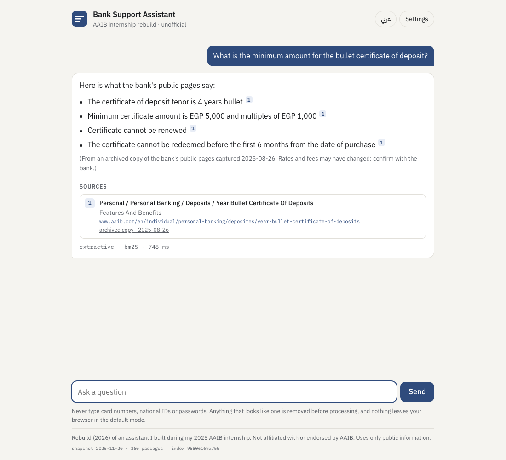

# Bank Support Assistant (AAIB internship rebuild)

> **Rebuild (2026) of an assistant I built during my 2025 AAIB internship. Not affiliated with or endorsed by AAIB. Uses only public information.**

From July to September 2025 I was a Software Engineering intern at the Digital Factory of Arab African International Bank (AAIB) in Cairo. There I built an end-to-end banking support assistant: an HTML/CSS/TypeScript frontend, knowledge scraped from the bank's public website, retrieval over that knowledge and local inference with Ollama. I documented its data flow for the bank's internal review, and the dev team adopted it. That code stayed with the bank. This repository is a rebuild from scratch, done in 2026 with more engineering discipline: a versioned and auditable knowledge snapshot, hybrid retrieval, guardrails that are tested, and an evaluation harness with measured numbers.

The default demo costs nothing to run. It is a static site with no server, no API keys and no paid model. Answers are extractive, which means they quote the source. An LLM is optional and runs inside the visitor's browser. Ollama is kept as a local dev provider, like in the original.



## What it does

- Answers questions about public retail, SME and corporate products, FAQs, complaints and security guidance, in **English and Arabic** (Arabic shown right to left).
- **Every answer cites its sources.** Each claim carries a citation marker, and each source chip links to the public page plus the exact archived capture it came from.
- **Never invents rates or fees.** Every number in an answer must appear in a cited source chunk. In extractive mode this holds by construction. In LLM mode a verifier removes any sentence with an unsourced number; if nothing verifiable is left, it falls back to the quoted text.
- **Refuses when the pages do not cover the question**, with the reply "I can't find that on AAIB's public pages", plus a handoff to the real support channel (hotline 19555 and the official contact page).
- **Guardrails on input:**
  - PII redaction (card numbers with a Luhn check, Egyptian national IDs with date and governorate validation, phone numbers, IBANs, e-mail addresses, long account numbers, also when typed in Arabic-Indic digits).
  - Prompt-injection screening on both scraped content and user turns.
  - Detection of out-of-scope questions, account actions and requests for investment advice.

## Architecture

```mermaid
flowchart LR
  subgraph Ingestion["Ingestion (Node, offline, polite)"]
    R[robots policy] --> D[CDX discovery<br/>allowlist of public paths]
    D --> F[fetch archived captures<br/>1 req / 2 s, cached, ledgered]
    F --> X[extract: HTML + RSC payload<br/>tables zipped into rows]
    X --> B[boilerplate removal<br/>injection quarantine]
    B --> C[heading-aware chunker]
    C --> S[(versioned snapshot<br/>data/snapshots/DATE)]
    S --> E[e5-small passage embeddings<br/>int8, 138 KB]
  end
  subgraph Browser["Runtime (static site, all in the browser)"]
    Q[question] --> P[PII redaction] --> G[scope + injection check]
    G --> BM[BM25] & DN[dense e5 query<br/>opt-in]
    BM --> RRF[RRF fusion] 
    DN --> RRF
    RRF --> RR[feature reranker]
    RR --> GATE{grounding gate}
    GATE -- no --> REF[refusal + support handoff]
    GATE -- yes --> EXT[extractive composer]
    EXT --> PROV[provider: extractive / Qwen2.5-0.5B in browser / Ollama]
    PROV --> V[numeric grounding verifier] --> UI[answer + citation chips]
  end
  S -. public/data/index.json .-> BM
  E -. public/data/embeddings.bin .-> DN
```

| Layer | Where | Notes |
|---|---|---|
| Ingestion | `ingest/` | `config.ts` (scope), `robots.ts`, `discover.ts`, `http.ts` (rate limit, retries, cache), `fetch-pages.ts`, `extract.ts`, `chunk.ts`, `run.ts`, `embed.ts` |
| Core (shared by browser and Node) | `src/core/` | `text.ts` (EN/AR normalisation, light stemmers), `bm25.ts`, `dense.ts`, `retrieve.ts`, `answer/extractive.ts`, `answer/grounding.ts`, `guardrails/*`, `providers/*`, `assistant.ts` |
| UI | `src/ui/`, `index.html` | Vite + TypeScript, no framework, streaming, source chips, EN/AR toggle, mobile layout |
| Eval | `eval/` | `golden.json` (58 questions), `run-eval.ts`, `table.ts`, `results/` |
| Tests | `tests/`, `e2e/` | Vitest (55 tests), Playwright (6 scenarios × desktop + mobile) |

### Data flow (as reviewed for the original)

1. **Source policy.** The live site sits behind a WAF that rejects automated clients. It also answers the `robots.txt` request with an HTML "Request Rejected" page. The crawler treats that as "automated access is not welcome" and does not try to get around it: no browser user-agent spoofing, no headless browser. It reads only **public captures in the Internet Archive** (`web.archive.org`, `id_` raw mode). If a parseable robots.txt is ever available, live or archived, its rules are applied to every path.
2. **Scope.** An explicit allowlist covers personal, SME and corporate product pages, FAQs, tariffs, customer rights and security tips. A denylist excludes careers, news, investor relations, people pages, FX rate feeds, logins and binary files. Result: 68 pages (35 EN, 33 AR).
3. **Politeness and audit.** One request every 2 s per host, an identifying User-Agent, backoff on 429/5xx and an on-disk cache so re-runs do not hit the network. Every capture fetched is written to `crawl-ledger.jsonl` with its archive URL, timestamp and SHA-256.
4. **Extraction.** Two site generations exist in the archive:
   - 45 pages are static HTML. They are walked as a DOM. Rate tables whose cells hold parallel lists are zipped into self-describing rows, for example `Frequency: Monthly; Amount: 100K to 500K; Interest: 4.250%`.
   - 23 pages are client-rendered. Their content is recovered from the React Server Components flight payload.

   Any block repeated on 30% or more of a locale's pages is removed as boilerplate.
5. **Injection quarantine.** Scraped blocks that look like instructions to a model are written to `quarantine.jsonl` and never indexed (0 in this snapshot). At runtime, sources are sanitised again and wrapped as data in the LLM prompt.
6. **Snapshot.** `data/snapshots/2026-11-20/` holds `pages.jsonl`, `chunks.jsonl` (360 chunks: 184 EN, 176 AR), `crawl-ledger.jsonl`, `quarantine.jsonl` and `manifest.json`. `public/data/index.json` is the deployable index, content-hashed (`version`).
7. **Runtime.** Everything below runs in the visitor's browser:
   1. The question is redacted first. Only the redacted text is used afterwards.
   2. Scope classification.
   3. Retrieval and the grounding gate.
   4. Answer composition, provider output, then the number check.

   Nothing is sent anywhere in the default mode. The optional models are downloaded from the Hugging Face CDN once and cached by the browser.

### Retrieval details

- **BM25** (k1 1.2, b 0.75). Heading and page-title tokens are counted twice. Tokenisation is language-aware:
  - Arabic: diacritics and tatweel are stripped, alef/ya/ta-marbuta forms unified, a light Light10-style stemmer is applied, and Arabic-Indic digits are converted.
  - English: light stemming.
  - Both: currency synonyms (dollar → usd) and product names written in either script (جولدن → golden) map to one token.
- **Dense** (opt-in): `Xenova/multilingual-e5-small` (q8, 118 MB, cached). Passage vectors are computed at build time and shipped int8-quantised (138 KB). The browser only embeds the query.
- **Fusion and rerank:** Reciprocal Rank Fusion (k 60), then a feature reranker that combines:
  - normalised BM25 score
  - IDF-weighted query-term coverage
  - heading match
  - bigram proximity
  - language match
  - numeric intent
  - dense cosine
- **Grounding gate:** the answer is refused unless the best chunk passes all three checks:
  - IDF-weighted coverage of at least 0.40 when the question uses banking vocabulary, 0.60 otherwise
  - reranked score of at least 0.42
  - less than 30% of the question's IDF mass on terms absent from the whole corpus (this catches "crypto savings account")

  These thresholds were set on the **dev split only**.

## Evaluation

`eval/golden.json` has 58 hand-written questions:
- 46 answerable: 28 EN, 18 AR, each with every acceptable source URL and, for 27 of them, the exact figure or phrase the answer must contain.
- 12 that must be refused: off-topic, unanswerable banking questions, account actions, advice requests and injection attempts.

The questions are split 29 dev / 29 test. Before scoring, the harness checks that every expected fact appears on one of its expected pages, so the golden set cannot drift from the snapshot.

Metrics:
- hit@k and MRR: the expected page is in the top k retrieved chunks.
- Citation accuracy: an answered question cites at least one expected page.
- Citation precision: the share of citation chips that point to an expected page.
- Fact recall: the expected figure appears in the answer.
- Refusal correctness: refused exactly when it should be.
- Numbers grounded: every number in an answer appears in a cited chunk.
- Latency.

Snapshot 2026-11-20, index 96806169a755, 360 chunks, v22.16.0, generated 2026-11-20T09:44:09.228Z.

#### Extractive provider, split: test

| config | hit@1 | hit@3 | hit@5 | MRR | citation acc. | citation prec. | fact recall | refusal correct. | false refusals | numbers grounded | retrieve p50 ms | total p95 ms |
|---|---:|---:|---:|---:|---:|---:|---:|---:|---:|---:|---:|---:|
| bm25 | 87 | 91.3 | 100 | 0.911 | 91.3 | 83.3 | 73.3 | 100 | 0 | 100 | 1.39 | 4.2 |
| bm25+rerank | 87 | 91.3 | 100 | 0.909 | 91.3 | 82.6 | 73.3 | 100 | 0 | 100 | 1.35 | 3.59 |
| dense | 91.3 | 95.7 | 100 | 0.946 | 100 | 84.9 | 84.6 | 93.1 | 8.7 | 100 | 7.86 | 12.17 |
| hybrid | 87 | 100 | 100 | 0.928 | 95.7 | 79.7 | 80 | 100 | 0 | 100 | 9.54 | 12.8 |
| hybrid+rerank | 87 | 95.7 | 100 | 0.914 | 91.3 | 84.1 | 73.3 | 100 | 0 | 100 | 9.47 | 13.29 |

#### Extractive provider, split: all

| config | hit@1 | hit@3 | hit@5 | MRR | citation acc. | citation prec. | fact recall | refusal correct. | false refusals | numbers grounded | retrieve p50 ms | total p95 ms |
|---|---:|---:|---:|---:|---:|---:|---:|---:|---:|---:|---:|---:|
| bm25 | 93.5 | 95.7 | 100 | 0.955 | 95.6 | 87 | 85.2 | 98.3 | 2.2 | 100 | 1.64 | 4.34 |
| bm25+rerank | 93.5 | 95.7 | 100 | 0.954 | 95.6 | 89.3 | 85.2 | 98.3 | 2.2 | 100 | 1.41 | 3.9 |
| dense | 93.5 | 97.8 | 100 | 0.962 | 100 | 88.6 | 87.5 | 91.4 | 10.9 | 100 | 8.13 | 12.17 |
| hybrid | 93.5 | 100 | 100 | 0.964 | 97.8 | 84.4 | 88.9 | 98.3 | 2.2 | 100 | 9.55 | 13.85 |
| hybrid+rerank | 93.5 | 97.8 | 100 | 0.957 | 95.6 | 90.7 | 85.2 | 98.3 | 2.2 | 100 | 9.69 | 14.59 |

#### Generative provider (local-llm), all questions

| config | hit@1 | hit@3 | hit@5 | MRR | citation acc. | citation prec. | fact recall | refusal correct. | false refusals | numbers grounded | retrieve p50 ms | total p95 ms | stripped sentences | extractive fallbacks | generate p50 ms |
|---|---:|---:|---:|---:|---:|---:|---:|---:|---:|---:|---:|---:|---:|---:|---:|
| bm25+rerank | 93.5 | 95.7 | 100 | 0.954 | 95.6 | 88.1 | 85.2 | 98.3 | 2.2 | 100 | 3.51 | 23764.85 | 55 | 45 | 11831 |

Per-language and dev-split tables: [`eval/RESULTS.md`](eval/RESULTS.md).

**Generative mode, measured.** Qwen2.5-0.5B-Instruct (transformers.js, int8, CPU) was run on all 58 questions through the same pipeline:
- It answered from general knowledge instead of the sources. Asked about the credit-card grace period, it said "typically between 5 to 14 days"; the source says "up to 55 days". Asked about the certificate minimum, it said "$100 to $10,000"; the source says EGP 5,000.
- The number verifier removed 55 sentences with unsourced figures from 22 answers.
- What remained never carried citation markers, so all 45 answered questions fell back to the quoted extractive answer.
- Result: 0 ungrounded numbers reached the user. A model this small adds nothing on top of extraction, which is why extractive is the default. The provider interface and the checks are what carry over to a stronger local model (for example via Ollama).

**How to read this honestly:**
- I wrote the questions after reading the snapshot, so these numbers are optimistic compared with real customers. They are most useful for comparing configurations and catching regressions.
- The test split was not used for tuning. The dev split was used for tuning, and its numbers are shown only for transparency.
- Test misses are real and are listed in `eval/results/extractive-all.per-question.json`. Examples: "How much balance do I need to join AAIB Edge?" retrieves the Wealth page first, and "What number do Wealth customers call?" is grounded on the wrong page.
- Paraphrases with no word overlap (for example "borrow quickly" for "Fast-Track Lending") are refused, even in hybrid mode, because the grounding gate is lexical. This is a deliberate trade: a false refusal with a handoff is cheaper than a confident wrong answer about money.
- On this set, dense retrieval improves hit@3 on test, but its lower lexical coverage raises false refusals. The demo therefore defaults to BM25 + rerank: instant, no download, best refusal behaviour. Hybrid is one click away.
- Latencies were measured in Node 22 on an Apple Silicon laptop and exclude model download time.

Reproduce: `npm run eval` (extractive, all five configs) and `npm run eval -- --provider local-llm --configs bm25+rerank` (generative), then `npm run eval:table`.

## Run it locally

```bash
npm install
npm run dev          # http://localhost:5173 (the Ollama option is visible in dev)
npm test             # 55 unit/integration tests (Vitest)
npm run e2e          # builds, serves on :4791 and runs Playwright against installed Chrome
npm run eval         # golden-set evaluation, writes eval/results/
npm run build && npm run preview   # production build on http://localhost:4791
```

Rebuilding the knowledge snapshot is optional, since the snapshot is committed. It reads the Internet Archive politely: about 70 requests, 2 s apart.

```bash
npm run ingest -- --snapshot 2026-11-20
npm run embed
```

Optional local Ollama provider (dev only): run `ollama pull qwen2.5:3b-instruct`, start Ollama with `OLLAMA_ORIGINS=http://localhost:5173`, then pick "Ollama" in Settings (append `?ollama=1` on a built site).

## Deploy to GitHub Pages (free)

The site is fully static, so it deploys with the included workflow `.github/workflows/pages.yml`.

1. Create an empty **public** GitHub repository, for example `aaib-assistant`. Pages is free for public repositories.
2. `git remote add origin git@github.com:<you>/aaib-assistant.git && git push -u origin main`
3. On GitHub, go to **Settings → Pages → Build and deployment → Source: GitHub Actions**.
4. The workflow runs `npm ci`, `npm test`, then `npm run build` with `BASE_PATH=/<repo>/`, and publishes `dist/`. The site appears at `https://<you>.github.io/aaib-assistant/`.

To build the Pages bundle by hand: `BASE_PATH=/aaib-assistant/ npm run build`, then publish `dist/`.

## Limits and non-goals

- The knowledge comes from archived captures (2024 to 2026, dated on every answer), not from the live site. Rates and fees may be out of date, and every answer says so.
- The FAQ page only renders its first tab (Q-Pay) in static HTML, so the other FAQ tabs are not in the snapshot.
- The generative mode uses a 0.5B model, so its prose is weaker than the extractive quotes. Its value is showing that a pluggable LLM can be wrapped in the same citation and number checks.
- No logo or brand styling of the bank is used. The name, colours and layout are neutral.

## License

Code: MIT. The snapshot text belongs to its publisher and is included only as public reference data for this non-commercial portfolio project.
